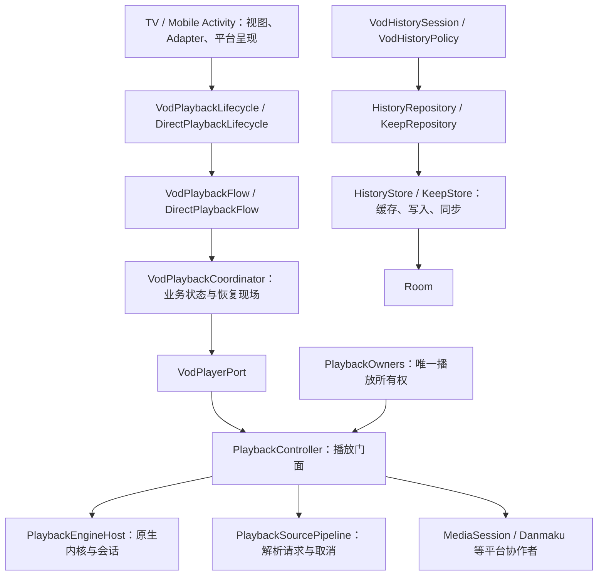

# 播放与数据架构重构

后续配置、存储依赖注入、页面Presenter及Flow串行执行的变更和最新验收见[边界重构记录](architecture-boundaries-2026-10-25.md)。本文保留此前阶段的结果。

用户授权：整体重构已识别的六处架构边界，保留功能、接口兼容性和数据格式，不以文件缩短为验收目标。

## 工作清单

- [x] 独立播放所有权及接管协议，Server只作为查询适配器。
- [x] 明确业务挂起与永久关闭；接管前捕获完整恢复现场。
- [x] 统一历史提交资格与两端保存接线。
- [x] 抽离身份编码；历史/收藏存储、缓存、同步迁入Repository存储层，实体兼容入口只委托。
- [x] 拆分PlaybackController的解析、准备及平台职责。
- [x] 两端共用播放Port与生命周期业务，保留具体UI呈现。
- [x] 补充边界行为测试，跑完整Java/Python测试、两端Java构建及lint；设备验收另列。

## 迁移原则

前一轮未提交修复全部保留。每个边界迁移后运行定向测试，最终重新运行全量验证。不提交或推送。兼容入口保留原签名但不得成为另一套业务实现；Room实体字段、schema版本、持久配置键均不改变。

## 最终职责与调用方向



- `PlaybackController.create()`只构造，初始化或页面恢复时显式接管。新所有者先发布，再撤销旧所有者；旧页面的销毁不能清除新页面的全局播放资源。
- `SUSPENDED`表示可恢复的业务挂起，`RELEASED`表示最终关闭。`VodPlaybackCheckpoint`保留影片/选集身份、进度、时长、倍速和用户播放意图；底层快照失败时回退到已有可信状态。
- `PlaybackEngineHost.releaseEngine()`释放可重建的原生资源；`close()`永久关闭并清除视图引用。`PlaybackSourcePipeline`统一取消代次、单次终态回调和过期结果隔离。
- `VodHistoryPolicy`统一提交资格。只有实际到达READY且身份和播放地址对应的路线才能提交；`VodHistorySession`统一两端采样、节流与接管保存。
- `PersistedEntryKey`集中解释现有身份格式，支持包含分隔符的视频ID及旧数据回退。History/Keep实体只保存数据；原存储方法为兼容委托，缓存、锁、队列、导入与同步由Store负责。
- TV点播、手机点播共享Port与生命周期；TV直播、手机直播、TV投屏共享直接播放恢复协议。Activity仍负责具体控件、列表和平台呈现；Controller仍提供兼容门面，并非取消所有平台差异。

### 手机后台播放与通知

每次播放接管分配独立lease；通知和PiP的PendingIntent带创建时的lease及独立URI。`PlaybackService`持有实例播放器和固定lease，旧服务不会随同一播放器再次接管而自动获得新权限，旧startId也不能停止新一次服务启动。

划走通知与显式STOP分别处理：前台页面不因过期通知删除而退出，后台删除可结束后台播放，显式STOP仍保留停止语义。UPDATE仍用于通知刷新，常规传输操作直接转为类型化`PlaybackInput`。兼容的旧EventBus入口仍保留，并未宣称已移除全App EventBus。

## 验收中额外修复

1. IJK暂停状态准备后收到BUFFERING_START，但可能直到恢复播放才收到BUFFERING_END，导致页面一直显示加载。现在按用户播放意图区分暂停与真实缓冲；有暂停和播放两种对照测试。
2. 手机点播进入直播后返回，旧通知删除事件可误关当前点播页。实际finish调用栈定位到通知STOP；用固定Service lease、明确删除语义及前台检查修复，原路径重新实测通过。
3. 历史快照复制曾把原始nullable字段变成空串，影响序列化一致性；新增数据格式与副本隔离测试后修复。

## 自动验证（2026-10-24，最终代码）

使用Android Studio JBR，离线执行：

```sh
./gradlew :core:test :quickjs:testDebugUnitTest :ijkplayer:testDebugUnitTest \
  :app:testLeanbackJavaArm64_v8aDebugUnitTest :app:testMobileJavaArm64_v8aDebugUnitTest \
  :app:assembleLeanbackJavaArm64_v8aDebug :app:assembleMobileJavaArm64_v8aDebug \
  --offline --console=plain --max-workers=2
./gradlew :app:lintLeanbackJavaArm64_v8aDebug :app:lintMobileJavaArm64_v8aDebug \
  --offline --console=plain --max-workers=2
python3 -m unittest discover -s chaquo/src/test/python -p 'test_*.py'
```

| 验证 | 结果 |
| --- | --- |
| TV Java单测 | 861，失败/错误/跳过均为0 |
| Mobile Java单测 | 834，失败/错误/跳过均为0 |
| core / QuickJS / IJK单测 | 46 / 3 / 4，全部通过 |
| Python bridge单测 | 8，全部通过 |
| 两端Java arm64 Debug APK | 构建成功 |
| TV lint | 0错误、177警告 |
| Mobile lint | 0错误、296警告 |
| diff空白 / schema / APK测试入口 | diff检查通过、schema无变化、普通包不含临时测试入口 |

共1748次Java测试执行加8次Python测试执行；两端会重复运行共享测试，不等同于1756个独立用户场景。新增覆盖包括所有权重入与过期lease、旧页面销毁、解析取消及重复回调、内核临时释放与永久关闭、恢复失败回退、历史提交与副本隔离、数据格式、Service固定lease和系统动作语义。

## 原生播放验收

在独立只读Android TV API34 arm64模拟器中安装隔离包，通过本地180秒640×360媒体和真实Exo/IJK播放路径，运行`tools/android-ui-smoke/refactor-device/ownership_smoke.py`。表中数值为接管前和返回后的毫秒位置，倍速为2倍。

| 路径 | 进度 | 返回状态 |
| --- | --- | --- |
| TV Exo暂停点播→投屏页→返回 | 30942→30942 | PAUSED，2倍 |
| TV Exo播放点播→投屏页→返回 | 30802→31212 | READY/播放，2倍 |
| TV直播→投屏页→返回 | 232→382 | 原频道，READY/播放 |
| TV IJK暂停点播→投屏页→返回 | 29349→29349 | PAUSED，2倍，IJK |
| Mobile暂停点播→直播→返回 | 30920→30920 | PAUSED，2倍 |
| Mobile播放点播→直播→返回 | 30227→31412 | READY/播放，2倍 |

全部观察到640×360原生视频尺寸。测试临时包、端口映射、媒体服务和只读模拟器已清理，普通APK已重建并检查Manifest。

Mobile是在TV模拟器运行手机变体；这不代表手机硬件验收。投屏通过本地接收入口进入实际CastActivity，未验证外部DLNA发现/传输协议。未验证实体遥控焦点、OEM解码、实体手机旋转、真实PiP按钮、第三方接口、其他ABI或Python flavor APK。以上边界不能用单测通过替代。
