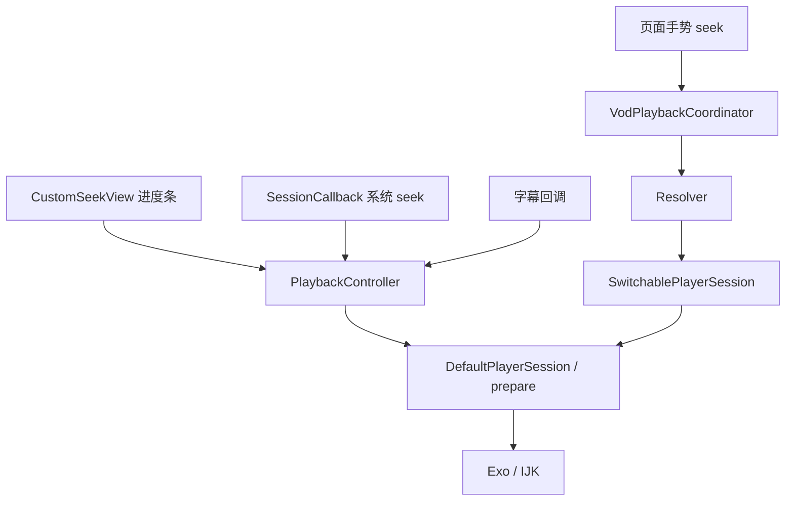

# VideoActivity 播放入口与重构审查

日期：2026-10-21；基线：`4e70e8ba8`。本轮审查两端 VideoActivity 的按钮注册、列表/对话框入口、播放器状态、解析/引擎回调、生命周期与系统媒体控制。生产代码未修改。

> 本文是历史基线审查；2026-10-22 已实施的重构、修复和验证见 [实施验收记录](/Users/wuwenjun/code/TV/docs/vod-refactor-validation-2026-10-22.md)。下文“当前”和代码行号指审查时的基线，不代表修复后状态。

## 结论

建议分阶段重构播放控制业务层。第一阶段应统一所有播放入口和会话切换顺序，并补充真实适配层回归；随后把恢复/换源规则与页面展示分开。保留现有播放器、解析器、资源和 TV/手机界面，逐步迁移。

判断依据是已复现的跨层错误，以及多条入口能绕开协调器，不是单纯因为 Activity 文件长。一次性改写 Activity、换内核或更换 UI 框架，会同时改变播放行为、生命周期和遥控器焦点，难以区分新旧问题。

## 1. 已确认的三个问题

### P1：暂停后加载外部字幕会自动播放

- 入口：两端 `setSubtitle` → `PlaybackController.setSub`。
- 触发：已有可播放 URL，当前处于暂停状态，选择不同外部字幕。
- 根因：`setSub` 直接走 `reloadMediaSource`，重新 prepare 的 PlaybackItem 使用默认 `playWhenReady=true`；没有使用协调器保存的用户暂停意图。
- 逻辑复现：暂停会话选择字幕后，拦截实际 PlaybackController 生成的 prepare 参数，得到 `playWhenReady=true`，预期为 false。
- 影响：用户暂停被解除；同一路径也绕过协调器对速度、位置和生命周期权限的统一恢复规则。
- 位置：[setSub](/Users/wuwenjun/code/TV/app/src/main/java/com/fongmi/android/tv/player/PlaybackController.java:249)、[直接 prepare](/Users/wuwenjun/code/TV/app/src/main/java/com/fongmi/android/tv/player/PlaybackController.java:719)。

### P1：IJK 加载字幕切 Exo 后，协调器可能一直停在 RELEASED

- 入口：IJK 点播选择外部字幕，需要切换到 Exo。
- 当前顺序：Controller 内部释放旧会话 → 创建新会话并 prepare → 返回 Activity → Activity 才 replacePlayerSession。
- 根因：旧会话的 RELEASED 将协调器的 acceptingSession 设为 false；新会话初始 PREPARING 与后续 READY 不会重新打开该门控，因为它没有经过协调器的 applyResolved/prepare 流程。
- 逻辑复现：按相同顺序操作真实 DefaultPlayerSession、SwitchablePlayerSession、VodPlaybackCoordinator，替换后的会话已经 READY，协调器仍为 RELEASED。
- 影响：实际引擎与协调器失去一致性。协调器的 play/pause 被门控拦截、历史提交失效，TV 页面也可能收不到正常 READY 展示。手机原始会话观察者能更新部分 UI，容易进一步掩盖状态分叉。
- 位置：[TV 字幕入口](/Users/wuwenjun/code/TV/app/src/leanback/java/com/fongmi/android/tv/ui/activity/VideoActivity.java:2293)、[手机字幕入口](/Users/wuwenjun/code/TV/app/src/mobile/java/com/fongmi/android/tv/ui/activity/VideoActivity.java:1797)、[Controller 字幕切换](/Users/wuwenjun/code/TV/app/src/main/java/com/fongmi/android/tv/player/PlaybackController.java:249)。

### P2：Exo PREPARING 时 seek 后，快照仍返回旧起播位置

- 触发：ExoPlayerEngine 仍在 PREPARING，收到新的 seek；在离开该阶段前又读取快照用于 reload/位置保留。
- 根因：seekTo 清除 pendingStartSeek 并调用 Exo，但不更新 requestedStartPosition；snapshot 在 PREPARING 中优先返回这个旧值。
- 逻辑复现：原起播 10 秒 → seek 40 秒；实际发送给 Exo 的 seek 是 40 秒，EngineSnapshot 仍返回 10 秒。
- 影响：在这个准备窗口内发生 reload/切换时，可能保留错误的位置。该窗口长度取决于真实内核事件时序，本轮没有测量设备上的发生概率。
- 位置：[seekTo](/Users/wuwenjun/code/TV/app/src/main/java/com/fongmi/android/tv/player/engine/ExoPlayerEngine.java:80)、[snapshot](/Users/wuwenjun/code/TV/app/src/main/java/com/fongmi/android/tv/player/engine/ExoPlayerEngine.java:107)。

以上三个问题均在 API 34 arm64 模拟器中，针对 TV 和手机当前 Debug APK 各执行一次逻辑复现。探针调用真实应用方法，外部播放器/会话依赖用替身控制时序；没有启动应用 Activity、加载真实媒体或修改应用数据。第二个用例复现真实调用顺序，未实际实例化 IJK/Exo 视频内核。

## 2. 控制链为何仍会反复出问题

### 2.1 输入没有统一经过协调器

- 进度条绑定的是 `mPlayers`，不是协调器：[TV](/Users/wuwenjun/code/TV/app/src/leanback/java/com/fongmi/android/tv/ui/activity/VideoActivity.java:768)、[手机](/Users/wuwenjun/code/TV/app/src/mobile/java/com/fongmi/android/tv/ui/activity/VideoActivity.java:485)。
- [CustomSeekView](/Users/wuwenjun/code/TV/app/src/main/java/com/fongmi/android/tv/ui/custom/CustomSeekView.java:154) 直接 `player.seekTo`。
- [SessionCallback](/Users/wuwenjun/code/TV/app/src/main/java/com/fongmi/android/tv/impl/SessionCallback.java:21) 的 seek 直达 Controller，play/pause/next/prev/stop 则走全局 ActionEvent。
- 字幕又能直接 prepare 或切换底层会话。

因此，上一轮修复的“解析期间 seek 保存到协调器状态”，不能自动覆盖进度条、媒体会话等入口。这里确认的是路由缺口，不声称所有入口都已在解析期间完成可见操作复现。

### 2.2 手机同时消费两个状态源

手机既观察 [mPlayers 原始会话](/Users/wuwenjun/code/TV/app/src/mobile/java/com/fongmi/android/tv/ui/activity/VideoActivity.java:412)，又观察 [协调器](/Users/wuwenjun/code/TV/app/src/mobile/java/com/fongmi/android/tv/ui/activity/VideoActivity.java:554)。前者控制大部分播放 UI 和恢复窗口，后者控制历史、推荐、部分错误处理。

而 PlaybackController [先通知观察者，再更新自己的 playerState](/Users/wuwenjun/code/TV/app/src/main/java/com/fongmi/android/tv/player/PlaybackController.java:795)。页面回调中混用事件参数和 `mPlayers.isBuffering()` 等缓存查询，会读到不同版本的状态。流量轮询可能随后纠正展示，但这不是可靠的状态提交顺序。本轮将其列为结构风险，没有把所有瞬时差异直接定性为永久 UI 故障。

### 2.3 页面仍承担控制策略和副作用排序

TV 2956 行、手机 2434 行；粗略源码统计分别有 286/248 个方法声明，包含重载和内部 Port 方法。TV 已拆出 Detail、Search、Navigation、Recovery、StateBinder，但这些 Port 大量回调 Activity，由 Activity 再调用 Controller/Coordinator。拆文件后，关键执行顺序仍由页面保证。

例如切内核必须正确排列“保留位置/暂停/速度、取消旧任务、释放、挂接新 delegate、prepare、恢复 UI”；字幕路径就漏过了这套顺序。散布的 takePlaybackControl 调用也要求每个新按钮作者自行区分用户操作和自动恢复，容易再次遗漏。

### 2.4 上一轮测试覆盖了核心规则，尚未覆盖所有真实接线

10×13 命令矩阵、36 种旧事件组合和恢复序列模型值得保留，但使用 FakeEngine，主要验证协调器接到事件后的行为。它们不会主动点击 CustomSeekView，也不会代替 Activity/Controller 完成字幕换内核或测试真实 ExoPlayerEngine.snapshot。

本轮重跑现有两端 1373 项单测仍通过，同时 APK 逻辑探针复现上述三个缺陷。这是明确的测试层次缺口。

## 3. 按钮和回调覆盖范围

完整登记见 [入口清单](/Users/wuwenjun/code/TV/docs/videoactivity-entry-inventory-2026-10-21.md)：TV/手机分别有 32/44 处显式 Listener 注册、8/6 处 Adapter/Presenter 构造入口、136/49 处 Override 回调。Override 包括内部 Port、异步回调与生命周期，不等于 185 个按钮。

| 功能组 | 跟踪入口与后续 |
|---|---|
| 播放/暂停 | 页面按钮、单双击、遥控中心键、ActionEvent、MediaSession、进入全屏 |
| 位置控制 | 触摸 seek、TV 快进退、控件 TimeBar、系统 seek、片头/片尾跳过、暂停回看 |
| 选择内容 | 剧集、路线、解析、画质、快捷站点、推荐、相邻集、倒序与分组 |
| 重新播放 | 错误重试、刷新、重置/重播、循环、自动下一集、外部 RELOAD |
| 内核与解码 | 手动内核、手动解码、自动回退、DRM 兼容、字幕兼容切换 |
| 轨道与字幕 | 视频/音频/内嵌字幕轨道、外部字幕文件、在线字幕结果 |
| 弹幕 | 数据加载/取消、文件选择、来源选择、开关、参数、速度同步 |
| 展示 | 全屏/返回、控件显隐、中央提示、错误、预览、比例、横竖屏、锁定、PiP |
| 其他按钮 | 收藏、演员/片段跳转、简介、更多、下载、复制、分享、投屏、设备选择 |
| 数据回包 | 详情 token、搜索 session、历史 TaskScope、下载结果、剧集回包、配置刷新 |
| 延迟回调 | 控件隐藏、流量/时钟、源切换超时、自动恢复、手势长按/单击、图片、弹幕准备 |
| 生命周期 | init、onNewIntent、start/resume/pause/stop/destroy、配置变化、窗口焦点、PiP 变化 |
| 解析 | 请求开始/取消、同步/异步完成、失败/重复/过期、结果预处理与二次解析 |
| Exo 事件 | playbackState、isPlaying、firstFrame、playerError；状态映射与起播 seek |
| IJK 事件 | prepared、completion、info 的缓冲/音视频/seek 渲染事件、bufferingUpdate、error、ready fallback |
| 会话和观察者 | DefaultPlayerSession、SwitchablePlayerSession 的 observe/replace/release、协调器重入/取消/关闭 |

无新增确定性缺陷的路径也不等于完成真机验收。列表/对话框内部控件通过回到本页的接口入口追踪，未将整个应用所有对话框的每个按钮都列为本轮真机点击通过。

## 4. 建议的分阶段重构

### 第一步：统一播放命令入口，并修掉已证实问题

在现有协调器前增加一个共享的点播操作接口，由 TV/手机、CustomSeekView、系统媒体控制及字幕/画质回调统一提交语义动作。输入至少区分用户动作、自动恢复、生命周期和内核事件。保留不同页面的 UI 行为。

字幕变更使用“保存意图 → 更新字幕选择 → 必要时替换并挂接 delegate → 经协调器 prepare”的同一流程。Vod 不再借 Controller 的旧式直接 reload 来绕过协调器；Live/Cast 的旧入口在独立迁移前保留。修复 Exo 准备阶段 seek 的快照一致性。

验收：上述三项先做失败回归再修复；四种 seek 入口（手势、TV 键、进度条、系统）均命中同一规则；字幕前后暂停/速度/位置保持；旧 session 无法修改当前影片。

### 第二步：共享播放流程状态机

保留既有 Coordinator/RecoveryWindow 核心，将 TV/手机重复的恢复动作、解析/路线/站点推进和用户取回控制规则收敛到共享流程层。事件携带影片/请求/会话归属，统一排队处理，避免观察者里同步发起多层新播放形成隐式重入。

状态分层保留为：播放阶段、恢复状态、播放意图/权限、页面展示状态。不要组合成数百个“全屏且缓冲且前台”等枚举。纯转换函数产生状态和待执行副作用；解析、引擎、历史等副作用完成后再送回带代次的事件。

验收：自动恢复有统一总预算；用户动作明确开始新预算；同一事件重放不会重复提交历史或推进两集；后台/返回/换片与迟到回调有序处理。

### 第三步：页面只保留渲染与平台交互

手机迁移到统一点播状态快照后，再移除页面对原始 PlayerSession 的重复业务观察。TV 的 Port 逐步改为向共享流程发送动作。页面保留 ViewBinding、焦点、遥控器映射、方向和 PiP 交互；页面展示读取同一版本快照，不在渲染中发起新的业务播放。

图片、弹幕、对话框和延迟任务绑定页面/影片代次，清理与过期判断有一致约定。每次只迁移一类入口，保留可比较的旧行为。

### 每个阶段都必须补足的验证

- 保留现有两端 Java 单测与 Debug 构建。
- 增加真实入口/适配层测试：Controller 字幕、TimeBar、SessionCallback、Exo/IJK 的实际适配方法；替身只控制外部引擎，不跳过被测适配方法。
- 回放相同事件序列：用户暂停→字幕/内核切换；解析中四类 seek→切集；失败恢复→READY→返回；换源→后台→旧回包；退出/销毁→延迟回调。
- 设备验收覆盖 Exo/IJK、TV 遥控焦点、手机横竖屏/PiP/后台通知，以及真实解析失败与正常结束。单测通过不替代这些场景。

不建议在这些提交中同时更换播放器库、引入新 UI 框架、改数据库/配置身份或删功能；它们没有消除本次证实的边界错误。

## 5. 本轮交付与未完成项

交付审查结论、76 处显式控件绑定与 185 处 Override 的逐入口清单，以及可重复运行的 APK 逻辑探针 [PlaybackBoundaryAudit.java](/Users/wuwenjun/code/TV/tools/android-ui-smoke/PlaybackBoundaryAudit.java)。探针的默认模式输出诊断；`--expect-fixed` 在缺陷仍存在时返回非零，不能把诊断进程成功退出误读为产品测试通过。运行方法见 [工具说明](/Users/wuwenjun/code/TV/tools/android-ui-smoke/README.md)。

本轮没有修改或重写生产代码，也没有修复或提交这三个新发现的问题。未逐个操作真实播放页面按钮，未用真实流完成字幕/seek/内核切换画面验收。模拟器运行的是可控依赖下的实际 APK 方法与会话状态顺序，已清理设备临时文件。
