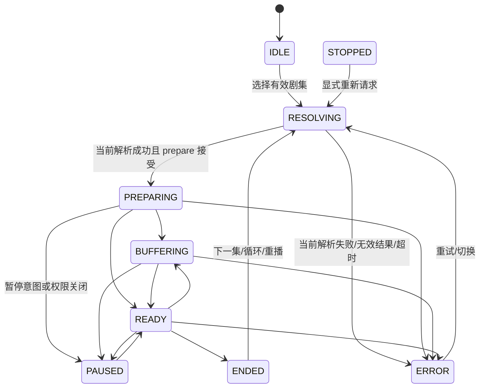

# VideoActivity / VodPlaybackCoordinator 状态机审查

日期：2026-10-21。范围：TV、手机 VideoActivity，VodPlaybackCoordinator，以及实际参与转换的 PlayerSession、RecoveryWindow、PlaybackRecovery、导航与历史提交门控。基于 `e88b4a565` 和本轮修改，包含上一轮返回键修复。

这里的“枚举”覆盖代码暴露的状态、事件类型、参数边界与关键交叉序列；异步事件序列可以无限延伸，不声称穷举所有设备和时序。确定性检查用状态表、矩阵和有界序列完成，真实播放与视觉验收另列。

## 1. 状态分层

| 层 | 状态/维度 | 责任 |
|---|---|---|
| 协调器播放阶段 | IDLE、RESOLVING、PREPARING、BUFFERING、READY、PAUSED、ENDED、ERROR、STOPPED、RELEASED | 播放目标、进度、错误与状态通知 |
| 请求 | requestId、pendingRequestId、ResolveHandle | 只接受当前请求的一次终结回调；取消旧请求 |
| 会话 | acceptingSession、sessionId、当前 episode identity、delegate identity | 隔离旧内核事件、旧播放器和无活动会话的控制命令 |
| 意图和权限 | playWhenReady × playbackAllowed | 用户暂停与生命周期暂停分别保留；允许播放必须同时满足两者 |
| 起播策略 | FRESH、RESUME_SAVED、KEEP_CURRENT_POSITION | 片头、匹配历史、当前快照、显式保留位置；0 是有效位置 |
| 恢复窗口 | IDLE、RECOVERING、STABILIZING、RECOVERED、CANCELLED | 自动恢复总时限、成功观察期、返回键归属 |
| 恢复动作 | RETRY、TOGGLE_DECODE、RELOAD_EXO、SWITCH_PLAYER、ADVANCE、STOP | 重试、解码/内核切换、解析/路线/站点推进、停止 |
| 页面 | 当前播放所有者、前后台、redirect、全屏、控件可见、锁定、手势/预览 | 决定是否消费事件和显示 UI；不代替播放阶段 |
| 数据 | 当前影片、路线、剧集、列表顺序、历史提交身份 | 防止切片后误用旧位置、列表刷新重播状态、失败路线覆盖历史 |

READY 是内核可播放状态，不直接等于已经持续输出可见画面；PAUSED 也不能反推用户暂停意图，生命周期可能暂停内核。

## 2. 播放阶段及主路径

图表示主要路径；任意未关闭阶段均可 stop→STOPPED、reset→IDLE、close→RELEASED，选择有效剧集均可进入 RESOLVING。内核也可能直接发出 PAUSED、ENDED 等快路径；不以固定 READY/BUFFERING 顺序判断事件归属，归属由请求和 session 代次控制。

| 阶段 | 进入条件 | 允许的关键后续处理 |
|---|---|---|
| IDLE | 初始化、新影片 reset | 有效选集；无当前剧集时 next/previous/reload/replay 返回 false |
| RESOLVING | play(index)/reload/replay/相邻集 | 当前解析成功/失败、取消、超时；pause/play 修改意图；seek 更新待起播位置 |
| PREPARING | 当前解析完成后的 session.prepare | 内核事件、用户控制、停止、超时 |
| BUFFERING | 当前会话缓冲 | READY/PAUSED/ERROR 等内核事件；seek 不强制播放或暂停 |
| READY | 当前会话可播放 | 正常控制、缓冲、结束；历史可提交；恢复进入观察期 |
| PAUSED | 内核暂停 | 隐藏加载提示，保留位置；是否自动恢复由意图与权限决定 |
| ENDED | 当前会话结束 | 循环、相邻集、边界提示；play() 发起 FRESH 重播 |
| ERROR | 解析、准备、内核或超时错误 | 根据恢复动作请求新播放；旧解析终结回调不能重复准备 |
| STOPPED | 显式 stop/取消自动恢复 | 拒绝旧会话与解析；保留可用于 reload 的位置；普通 play() 不重建会话 |
| RELEASED | 协调器 close，或底层会话释放通知 | close 后控制不再触达内核；底层单独释放时需替换 delegate 后重新请求 |

注意：底层 RELEASED 通知与协调器 close 不是同一个变量。前者允许 Activity 替换播放器，后者是协调器的最终关闭。

## 3. 用户命令矩阵

符号：`R`=RESOLVING，`S`=STOPPED，`I`=IDLE，`X`=RELEASED，`=`=阶段由当前内核事件决定，命令本身不伪造 READY/PAUSED。

| 命令 | 无当前剧集 | 已选择剧集的阶段 | close 后 |
|---|---|---|---|
| SELECT(index, policy) | 有效参数→R | R，先失效旧请求再取消/停止 | 拒绝 |
| NEXT / PREVIOUS | false | 有目标→R；边界 false，不循环 | 不触达内核；有目标的操作拒绝 |
| RELOAD | false | R，KEEP_CURRENT_POSITION | 不触达内核 |
| REPLAY | false | R，FRESH | 不触达内核 |
| PLAY | 只记录意图 | ENDED→R；其余仅活动会话且权限允许时 play | 拒绝 |
| PAUSE | 只记录意图 | 活动会话 pause；解析期间保留暂停意图 | 拒绝 |
| SEEK(position) | 忽略 | R 保存待起播位置；活动会话 seek；STOPPED 忽略 | 拒绝 |
| BACKGROUND | 关闭播放权限 | 不覆盖用户意图；暂停内核；解析完成也不得偷播 | 拒绝 |
| FOREGROUND | 开启播放权限 | 仅活动会话且用户想播放时恢复 | 拒绝 |
| STOP | S | S，失效请求、取消解析、拒收旧事件 | 拒绝 |
| RESET | I | I，清空影片列表、续播、格式与一次性保留位置 | 拒绝 |
| CLOSE | X | X，取消定时器/订阅/解析并释放 | 幂等 |

已用 10 个阶段 × 13 类命令测试；PREVIOUS 使用存在前一集的初始位置，NEXT 使用存在后一集的位置，边界另有定向测试。矩阵检查状态结果与关闭后不再命令内核，不能替代所有内核的真实行为。

## 4. 异步事件清单与检查规则

| 事件族 | 枚举 | 检查点 |
|---|---|---|
| 解析终结 | 成功、失败、null、错误 requestId、重复完成、同步完成、同步抛错 | 只允许当前 pendingRequestId 完成一次；prepare 前再次检查 requestId/closed |
| 解析取消 | 换集、reload、stop、timeout、close、cancel 中同步回调 | 先失效请求再取消；旧回调不准备播放器 |
| 内核状态 | IDLE、PREPARING、BUFFERING、READY、PAUSED、ENDED、ERROR、STOPPED、RELEASED | delegate/sessionId/episode 身份过滤；解析期间不接受旧内核结果 |
| 定时器 | 解析/准备/缓冲超时、旧请求定时器、READY 后旧启动定时器、恢复 45 秒、成功稳定 5 秒 | 同一次等待不因 seek/阶段变化延长；取消与代次检查；成功后不再误停 |
| 观察者 | 初始快照、正常状态、异常、回调中 stop/close/换请求 | 单个观察者异常不破坏播放；重入后不继续广播过期状态 |
| 列表数据 | 重排、删除当前项、同名剧集、地址刷新、新影片 | 不用旧下标播放另一集，不重播 READY/ENDED 副作用，不跨影片继承位置 |
| 引擎切换 | 用户换内核、解码切换、DRM 兼容切换、自动换内核、外部释放 | 替换 delegate；保留需要的暂停/速度/位置；旧 delegate 事件隔离 |

旧内核事件另有 4 个拒收阶段 × 9 类事件 = 36 个组合测试。解析同步/重复/取消、超时、观察者重入、列表重排与位置保留由现有定向测试及本轮新增用例共同覆盖。

## 5. 自动恢复的明确状态机

原来的 active/cancelled 不能区分“还在切换”和“成功后保留总预算”。现改为显式枚举：

| 当前状态 | begin/再次错误 | READY | 非 READY 快照 | cancel/返回取消 | reset/新操作 | 稳定 5 秒 | 总预算到期 |
|---|---|---|---|---|---|---|---|
| IDLE | RECOVERING | IDLE | IDLE | CANCELLED | IDLE | IDLE | IDLE |
| RECOVERING | RECOVERING，不重置总预算 | STABILIZING | RECOVERING | CANCELLED | IDLE | RECOVERING | CANCELLED，通知失败 |
| STABILIZING | RECOVERING，不重置总预算 | STABILIZING，不重排计时 | RECOVERED，取消稳定计时 | CANCELLED | IDLE | IDLE | IDLE，不停成功播放 |
| RECOVERED | RECOVERING，不重置总预算 | STABILIZING | RECOVERED | CANCELLED | IDLE | RECOVERED | IDLE，不停成功播放 |
| CANCELLED | 拒绝 | CANCELLED | CANCELLED | CANCELLED | IDLE | CANCELLED | CANCELLED |

`RECOVERED` 表示已经见过 READY，随后有暂停/缓冲等非 READY 快照；保留预算但不再占用返回键。只有新的实际错误调用 begin，才重新进入 RECOVERING。

返回键仅在 RECOVERING 时取消自动恢复。其他状态按页面原有优先级处理：TV 为 seek→控件→中央提示→全屏→退出，手机为控件→全屏（受锁定限制）→退出。不会承诺按一次返回必定退出全屏。

恢复模型测试覆盖 5 个初始状态下全部长度为 4 的事件序列：5 × 7⁴ = 12,005 条，逐步检查阶段、返回键归属、失败通知次数和待执行计时器数量。定时事件按测试显式触发，不是假装模拟连续真实时间。

## 6. VideoActivity 事件入口审查

| 入口 | TV / 手机对应处理 | 结论 |
|---|---|---|
| 选路线/剧集/解析/站点 | onFlagClick、setEpisodeActivated、onParseClick、导航 Port / onItemClick、onParse | 用户操作重置恢复预算；自动推进使用内部路径保留预算；当前路线先判重 |
| 下一集/上一集 | checkNext/checkPrev，遥控回调、按钮、ActionEvent；ENDED/片尾也可调用 | 新的选集操作不继承 CANCELLED；顺序与倒序、边界仍按原逻辑 |
| 刷新、重播、画质 | onReset/onRefresh、质量点击、PlaybackCommand.RELOAD | 明确用户操作时取回控制权；自动重试不经用户入口重置预算 |
| 解码与内核 | onDecode(save)、onPlayerClick、RecoveryController/nextPlayer | 用户入口重置预算；onDecode(false) 与自动内核切换保留当前恢复预算 |
| PLAY/PAUSE | 遥控中心、触控、ActionEvent、进入全屏 | 协调器保留播放意图；全屏入口仍沿用原有主动播放行为 |
| SEEK | TV onSeeking/onSeekTo；手机 onSeek/onSeekEnd/onSeekCancel | 不强制改变播放意图；解析期间目标保留到 prepare；取消不提交 seek |
| READY/PAUSED/BUFFERING | TV renderPlayback / 手机 onPlaybackState 与协调器观察者 | UI、恢复窗口、历史与请求阶段分别处理；保留两端原有展示结构 |
| 前后台/销毁 | onStart/onResume/onPause/onStop/onDestroy | 权限门控与用户暂停分开；销毁释放订阅、解析、计时器、播放器 |
| 手机复用 Activity | onNewIntent | 不同影片清空恢复窗口、恢复计数和一次性起播意图；同影片保持原逻辑 |
| BACK | TV dispatchKeyEvent/onBackPressed；手机 onBackPressed | 成功观察期不再取消播放；仅正在恢复时消费取消 |
| 详情/搜索回包 | detail token、source switch 状态、search session | 当前 token/请求归属核查；搜索清理不替代播放器请求取消 |
| 字幕/弹幕/选轨 | 文件结果、在线结果、command、字幕引起的兼容切换 | 保留原行为；状态机不把加载字幕等同于新影片或用户换集 |
| 展示与手势 | 全屏、控件、锁定、方向、PiP、速度、亮度、音量、缩放 | 独立于播放阶段；前序手势 release 与预览清理保留 |

## 7. 确认并修复的问题

1. 成功后返回仍显示停止切换：恢复预算被当成正在恢复。返回键改用 isRecovering；成功时总预算到期也不再停止播放。
2. READY 重复快照推迟稳定期：每个快照都重新 post 5 秒。STABILIZING 内的 READY 变为幂等，暂停/缓冲后重新 READY 才重建稳定观察期。
3. 解析期间 seek 丢失：旧实现 seek 到已停止内核，prepare 仍使用解析开始时捕获的位置。现在记录在当前请求状态，prepare 读取最新目标；IDLE/STOPPED 不命令旧内核。保留暂停意图、总超时和换集隔离。
4. 手机重复点当前路线误停：取回控制权发生在判重之前。提前判重；成功观察期的取回控制权也不再停止成功播放。
5. 取消状态污染后续用户操作：不同影片 onNewIntent，以及下一集/上一集、画质、手动内核/解码、外部明确刷新入口补齐恢复 reset。自动解码重试、自动换源不借此获得新的总预算。

问题 1～4 有修复前失败、修复后通过的定向证据。问题 5 的恢复状态转换由模型覆盖，Activity 各入口接线通过静态调用追踪与两端编译检查，未声称每个入口都独立做过设备复现。

## 8. 验证和边界

最终验证：TV 696 项、手机 677 项 Java 单测，共 1373 项通过，0 失败/错误/跳过；两端对应 Java arm64 Debug APK 构建通过。TV lint 无错误、184 条警告，手机 lint 无错误、296 条警告；`git diff --check` 通过。矩阵/有界序列是这些测试内部的组合检查，不额外算作 12,005 个独立 JUnit 用例。

执行任务：`:app:testLeanbackJavaArm64_v8aDebugUnitTest`、`:app:testMobileJavaArm64_v8aDebugUnitTest`，两端对应 `assemble...Debug` 和 `lint...Debug`，使用 `--offline --console=plain --max-workers=2`。矩阵与模型测试分别位于：

- [协调器测试](/Users/wuwenjun/code/TV/app/src/test/java/com/fongmi/android/tv/player/vod/VodPlaybackCoordinatorTest.java)
- [恢复状态机测试](/Users/wuwenjun/code/TV/app/src/test/java/com/fongmi/android/tv/player/RecoveryWindowStateMachineTest.java)
- [恢复定向回归](/Users/wuwenjun/code/TV/app/src/test/java/com/fongmi/android/tv/player/RecoveryWindowTest.java)
- [TV 页面回归](/Users/wuwenjun/code/TV/app/src/testLeanback/java/com/fongmi/android/tv/ui/activity/PlaybackReselectionTest.java)
- [手机页面回归](/Users/wuwenjun/code/TV/app/src/testMobile/java/com/fongmi/android/tv/ui/activity/PlaybackReselectionTest.java)

页面用例是隔离 UI 初始化的 JVM 回归，模型使用手动 resolver/engine/scheduler。没有完成实际电视 Exo/IJK 视频画面、真实失败站点自动换源、全部遥控焦点、手机旋转/PiP/后台通知与实际字幕/弹幕的设备组合验收。也没有将“已检查事件入口”表述为每个入口均有真机或自动化覆盖。
